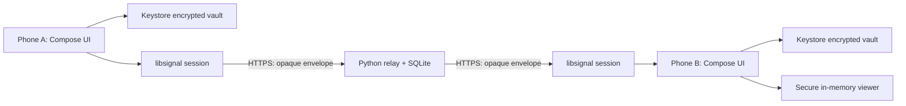

# Architecture and decisions

## Repository audit / Phase 0

The supplied `/workspace` contained only empty infrastructure/download directories. No application, repository history, AGENTS.md, tests or usable Android infrastructure existed. Files are created under `/workspace/veil` to avoid modifying managed hidden directories. Available locally: Python 3.12.14 and OpenJDK 21. Missing: Gradle, Kotlin compiler, Android SDK, adb, emulator, devices. The configured HTTP proxy refuses connections. Socket creation is also denied. Public upstream source was inspected through the connected GitHub reader; binaries and builds remain unavailable.

## Components

`MainActivity` owns authentication, lifecycle concealment and a process-wide coroutine mutex. `Messenger` applies application validation and transactional state changes. `SignalSession` invokes libsignal; it does not implement a cipher, key agreement or ratchet. `Vault` is an Android Keystore AES-256-GCM authenticated snapshot written with `AtomicFile`. `RelayClient` uses bounded HTTPS responses and no redirects. `SecureMediaView` owns synchronous native input concealment, ExoPlayer and watermark drawing. Compose builds the surrounding UI. The relay has no client imports, public-key directory or decryption API.

## Encryption and identity

Use Signal's maintained `org.signal:libsignal-client` and `libsignal-android` **0.105.0**, verified as the upstream latest release on 2026-10-15. Source signatures were checked at that tag. The current bundle requires a signed Kyber prekey; initialization supplies it, the signed elliptic-curve prekey and a one-time elliptic-curve prekey. `SessionBuilder` performs protocol establishment, `SessionCipher` performs encryption/decryption. All text, media bytes, media type, display mode, recipient watermark label, viewing limit, message ID and authoritative expiration are inside the encrypted payload. We use library defaults for the ratchet; no custom negotiation or downgrade is implemented.

Protocol specifications and public analysis are evidence for the protocol choice, **not an audit of Veil or proof that this adapter works**:

- https://signal.org/docs/specifications/pqxdh/
- https://signal.org/docs/specifications/doubleratchet/
- https://eprint.iacr.org/2016/1013 — formal analysis of the Signal protocol (older classical protocol, not this entire current implementation).
- https://github.com/signalapp/libsignal/releases/tag/v0.105.0

Both phones create inboxes, privately exchange public bundles and write capabilities, and manually compare the same complete 60-digit safety number. This uses libsignal's NumericFingerprintGenerator at 5200 iterations, version 2; serialized public identity keys serve as the stable installation identifiers because Veil has no phone-number accounts. All twelve five-digit groups must match. The original full SHA-256 identity fingerprints remain in an expandable section for comparing with 0.1.1. These are display/checking functions, not a key agreement. See ONBOARDING.md for compatibility and test details. Signal addresses are stable UUID-shaped identifiers derived from identity fingerprints; they do not carry telephone numbers. The comparison gate blocks send/receive until confirmed. Pinning rejects changed identity keys. The app cannot determine whether the user really compared codes; the label says “identity compared,” not remotely certified.

Invitations request import within 24 hours and target one peer. This timestamp is an honest-client check, not cryptographic revocation: routing capabilities remain valid for the 30-day mailbox lifetime and a modified invitation can change its unsigned expiry. The app accepts only the same relay origin, valid formats and a different identity. They are not signed containers: tampering with routing fields can cause denial of service or correlation. Confidentiality rests on authenticated protocol signatures plus out-of-band identity comparison, not trusting invitation transport alone. Public-key prekeys are never uploaded to the relay, reducing its ability to substitute bundles. A stolen invitation grants write access/spam capability, not read access or plaintext access.

Kyber base-key reuse markers are persisted, rather than trusting the library's in-memory test store to remember them across restarts. Session records, prekey consumption and these markers are saved together. Signed/PQ prekey rotation and graceful inbox renewal are outstanding; this is a bounded two-person trial, not a long-lived production key service.

## Durable delivery

Sending: validate → create authenticated payload → libsignal encrypt → atomically persist ratchet + exact ciphertext outbox + local message → PUT ciphertext. Retry reuses the stored ciphertext and ID. Never re-encrypt after an ambiguous upload result. Server acknowledgement only marks “Relayed.”

Receiving: GET oldest envelope without deleting → check replay marker → libsignal decrypt/validate → atomically persist ratchet + message + seen ID → DELETE acknowledgement. A crash between commit and ack is safe: a repeated envelope is acknowledged without decrypting twice. Server receipts make PUT idempotent even after receiver acknowledgement until its original envelope expiry. Network failures leave the outbox intact. Persistence failures never silently generate a new identity.

The mutex serializes operations across Activity recreation. Operations reload the committed vault so failed validation does not accidentally persist speculative ratchet state. If the process dies, `AtomicFile` recovers the last committed snapshot. The integration tests still need to verify crash boundaries on Android.

## Storage and media

Identity private keys and ratchets are **wrapped by** a nonexportable Android Keystore AES key; Curve/Kyber private keys themselves are not hardware-resident because libsignal needs their bytes. Hardware backing is device-dependent and is not claimed in UI. `setUnlockedDeviceRequired(true)` also ties use to the OS unlock state. The biometric dialog gates app entry; the AES key does not require a per-operation BiometricPrompt CryptoObject. Root/in-process code execution after OS unlock can defeat this boundary.

The authenticated encrypted vault lives under `noBackupFilesDir`. Cloud backup and device-transfer rules exclude app data. No database, thumbnails or plaintext temp files exist on the client. Media uses Android's temporary picker URI grant on import, then encrypted inline transport/storage, then Bitmap/Media3 `ByteArrayDataSource` in the viewer. No FileProvider/exported content provider is registered. Player surfaces are secure and the enclosing window is secure. Arrays/bitmaps are cleared/recycled where possible; JVM strings, decoder buffers and OS graphics memory cannot be guaranteed erased.

Deliberate v0.1 simplification: inline media, no object store or attachment-key protocol. At most 5 MiB per attachment, 15-second source videos, 24 million image pixels, 80 retained messages, 20 pending sends, approximately 24 MiB serialized local state. This favors a small demonstrable protocol surface over streaming throughput. The vault is read while unlocked to poll, which is inefficient and still needs memory profiling. Media import does not strip EXIF; a malicious recipient may recover metadata from decrypted bytes.

## Privacy and expiration semantics

Normal: open media on tap, visible text. Protected: initially concealed media; hold to reveal. Eyes-Only: same protected media plus hold-to-read message bubbles. All three modes retain the secure-window restriction and omit export/copy controls. The stronger baseline is explicitly stated in the UI.

The watermark uses 12 hex digits of recipient identity plus a message marker and UTC time. It repeats and drifts over the media. It is not a digital signature or proof of capture origin. The receiver computes its own identifier rather than accepting an arbitrary identifying label from the sender.

Message lifetime starts at **sender send time**, including delivery delay. Receiver render checks and local pruning honor the authenticated deadline. Relay TTL is only a delivery/storage hint and may be shortened by the relay; extending it cannot extend the encrypted deadline. Relay expiry is swept every 30 seconds and on every request. Local encrypted expired records are pruned when unlocked; no claim of immediate disk erasure while the app is stopped.

The optional viewing limit is **15 seconds starting on first media opening**, including concealed time; it is not 15 seconds of cumulative exposure. The opening deadline is persisted before rendering. The active viewer checks both wall time and a monotonic deadline. Reopening does not reset it. The UI labels this precisely. Clock rollback across process restarts, restored snapshots and modified recipients remain bypasses.

## Relay scope

Python standard library + SQLite behind Caddy TLS. Random independent 256-bit reader/writer bearer capabilities, stored as hashes; random mailbox/message IDs. No accounts, phone numbers, contacts, device push tokens or analytics. At most 1,000 mailboxes, 60 registrations/hour/process, 100 queued messages/box, 64 MiB/box and 256 MiB global payload quota, 100,000 receipt markers and eight simultaneous connections. No logging of request paths, IPs, capabilities or bodies in the Python handler. Default Caddy access logs are off.

The relay/operator still observes traffic timing, IPs at the TLS boundary, sizes, mailbox access and expiry. There is no padding, traffic mixing, sealed sender, censorship resistance, or anonymity claim. A compromised relay can delete/reorder/replay/delay ciphertext, exhaust quotas or deny service. It cannot legitimately decrypt payloads or replace a confirmed identity. Malformed oldest envelopes currently block reception until their TTL or operator removal; this availability issue needs quarantine handling. Failed outgoing delivery can also delay incoming sync; improved scheduling is pending.

## Orb build environment update — 2026-10-15

At the user’s request the standalone project was added to `Soldsoul86/orb`, branch `codex/veil-apk`, under `apps/veil`. Orb’s repository instructions and settled architecture were reviewed before adding files. Private-message data is not written to Orb’s permanent event journal. The root Veil GitHub Actions workflow supplies Java, Gradle, Android SDK and NDK tooling that remain unavailable in the local workspace. Actual CI results supersede the initial local build blocker above; see STATUS.md. Existing Orb services and probes are independent.
